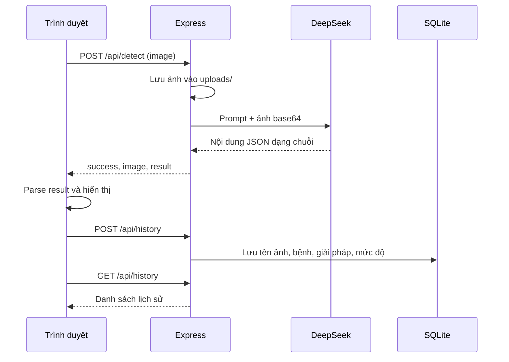

# AgroCare AI

Ứng dụng web tiếng Việt hỗ trợ phân tích ảnh cây trồng bằng DeepSeek, lưu lịch sử nhận diện và xuất báo cáo Excel có ảnh. Backend dùng Node.js/Express, dữ liệu lưu trong SQLite, giao diện HTML/CSS/JavaScript được phục vụ trực tiếp bởi server.

## Chức năng

- Chọn hoặc kéo thả ảnh, xem trước và gửi phân tích AI.
- Hiển thị tên bệnh, độ tin cậy do AI trả về, mức độ, nguyên nhân, hướng xử lý, thuốc đề xuất và cách phòng tránh.
- Sao chép kết quả, xem và tìm kiếm lịch sử, xuất JSON hoặc Excel, xóa toàn bộ lịch sử.
- Nhúng ảnh của từng lần phân tích vào đúng dòng trong file Excel; ảnh được thu nhỏ và giữ tỷ lệ.
- Gửi và xem đánh giá, tính điểm sao trung bình; backend có API sửa, xóa và thích đánh giá.
- Giao diện sáng/tối, lưu lựa chọn trong localStorage.

## Yêu cầu

- Node.js và npm. Dependency `sharp` trong lockfile yêu cầu Node.js **>= 20.9.0**; dự án đã được kiểm tra trên Node.js **26.13.0**.
- Khóa DeepSeek API để chạy nhận diện ảnh. Không cần khóa để khởi động server hoặc chạy test.
- Internet để gọi DeepSeek và tải tài nguyên giao diện từ CDN: Tailwind CSS, SweetAlert2, Font Awesome, Google Fonts.
- Quyền ghi vào thư mục dự án để tạo database và lưu ảnh.

Nên đặt dự án trên ổ đĩa cục bộ, ví dụ `C:\Carrot-Project\AgroCare-AI`. Thư mục đồng bộ Google Drive từng gây lỗi ghi file khi cài `node_modules` trên môi trường phát triển này.

## Cài đặt và chạy

```sh
git clone https://github.com/anhmac0106-dev/AgroCare-AI.git
cd AgroCare-AI
npm ci
```

Tạo cấu hình **một lần**, không ghi đè `.env` đã có khóa của bạn.

Windows PowerShell:

```powershell
Copy-Item .env.example .env
```

macOS/Linux:

```sh
cp .env.example .env
```

Điền khóa trong `.env`:

```dotenv
PORT=3000
DEEPSEEK_API_KEY=your_deepseek_api_key
DEEPSEEK_MODEL=deepseek-flash
```

```sh
npm start
```

Mở [http://localhost:3000](http://localhost:3000). Luôn chạy lệnh từ thư mục gốc dự án vì đường dẫn `public`, `database` và `uploads` hiện được tính theo thư mục làm việc. Không mở `public/index.html` trực tiếp bằng `file://`.

| Lệnh | Công dụng |
| --- | --- |
| `npm ci` | Cài dependency theo `package-lock.json` |
| `npm start` | Chạy `node server.js` |
| `npm run dev` | Chạy với nodemon, tự khởi động lại khi mã nguồn thay đổi |
| `npm test` | Chạy test bằng Node.js test runner |

Không có bước build frontend. Sau khi sửa backend hoặc `.env`, khởi động lại server; sau khi sửa frontend, tải lại trang bằng Ctrl + F5 nếu trình duyệt còn dùng bản cũ.

## Cấu hình

| Biến | Mặc định | Ý nghĩa |
| --- | --- | --- |
| `PORT` | `3000` | Cổng HTTP của Express |
| `DEEPSEEK_API_KEY` | Trống | Bắt buộc khi gọi nhận diện; chỉ được đọc ở backend |
| `DEEPSEEK_MODEL` | `deepseek-flash` | Tên model gửi tới DeepSeek; cấu hình hiện tại dùng V4.1 Flash |

Endpoint được đặt trong `deepseek.js`: `https://api.deepseek.com/chat/completions`. Request gồm prompt tiếng Việt và ảnh base64, yêu cầu JSON, tắt thinking, giới hạn đầu ra 4.096 token và timeout 120 giây.

**Đổi cổng hoặc triển khai lên máy khác:** `API_URL` trong `public/app.js` hiện cố định là `http://localhost:3000`. Cần cập nhật địa chỉ này tương ứng với backend. Riêng nút xuất Excel gọi đường dẫn cùng origin `/api/history/export-excel`.

## Cách sử dụng

1. Mở ứng dụng, chọn ảnh hoặc kéo ảnh vào vùng tải lên.
2. Dùng JPEG, PNG, GIF hoặc WebP; giới hạn upload là **10 MiB/ảnh**.
3. Bấm **Nhận diện bằng AI**, chờ kết quả và lịch sử được cập nhật.
4. Bấm **Xuất JSON** để tải `history.json`, hoặc **Xuất Excel** để tải `AgroCare_AI_Thong_Ke.xlsx`.

Báo cáo Excel gồm STT, tên bệnh, mức độ, hướng xử lý, hình ảnh và thời gian. Ảnh được chuyển thành thumbnail PNG, nhúng trong workbook và neo vào dòng tương ứng ở cột E. File Excel có thể xem ảnh mà không cần kết nối lại server. Nếu ảnh gốc mất hoặc không đọc được, ô ảnh hiển thị thông báo thay vì làm hỏng toàn bộ báo cáo.

## Luồng xử lý



`POST /api/detect` **không tự lưu lịch sử**. Frontend thực hiện bước lưu riêng sau khi nhận diện thành công. Nếu tích hợp client khác, cần thực hiện cả hai request.

## API

Các request JSON dùng `Content-Type: application/json`. Ngoại lệ: nhận diện dùng `multipart/form-data` và xuất Excel trả dữ liệu nhị phân.

| Method | Endpoint | Dữ liệu / công dụng |
| --- | --- | --- |
| GET | `/api/ping` | Kiểm tra server; trả `success`, `message` |
| GET | `/api/check-ai` | Trả `ai: true` nếu có khóa khác rỗng; không gọi DeepSeek để xác thực |
| POST | `/api/detect` | File trong field `image`; trả `success`, `image`, `result` |
| POST | `/api/history` | JSON: `image`, `disease`, `solution`, `level`; trả ID bản ghi |
| GET | `/api/history` | Lịch sử mới nhất trước, trong `data` |
| DELETE | `/api/history` | Xóa tất cả bản ghi lịch sử, không xóa file ảnh |
| GET | `/api/history/export-excel` | Tải workbook `.xlsx` có ảnh |
| GET | `/api/statistics` | `statistics`: `total`, `light`, `medium`, `heavy` |
| POST | `/api/reviews` | JSON: `name`, `star`, `content` |
| GET | `/api/reviews` | Danh sách đánh giá mới nhất trước |
| PUT | `/api/reviews/:id` | Cập nhật `name`, `content`; không cập nhật số sao |
| DELETE | `/api/reviews/:id` | Xóa một đánh giá |
| POST | `/api/reviews/:id/like` | Tăng số lượt thích |

Ví dụ gọi nhận diện trong PowerShell:

```powershell
curl.exe -X POST http://localhost:3000/api/detect -F "image=@C:/Images/leaf.jpg"
```

Dạng phản hồi thành công (minh họa):

```json
{
  "success": true,
  "image": "1795272586956.jpg",
  "result": "{\"disease\":\"Tên bệnh\",\"confidence\":\"--\",\"level\":\"Nhẹ\",\"cause\":\"...\",\"solution\":\"...\",\"medicine\":\"...\",\"prevent\":\"...\"}"
}
```

`result` là **chuỗi JSON**, cần `JSON.parse` trước khi lấy các trường để lưu. API hiện không kiểm tra đầy đủ schema kết quả AI hoặc dữ liệu ghi lịch sử. Thiếu file nhận diện trả HTTP 400; lỗi phân tích được trả HTTP 500 với trường `error`. Lỗi upload từ middleware có thể có định dạng phản hồi khác.

## Cấu trúc dự án

```text
AgroCare-AI/
├── server.js                # Express, upload, API và static files
├── database.js              # Kết nối SQLite, tạo bảng khi chạy
├── deepseek.js              # Gửi ảnh và prompt tới DeepSeek
├── prompt.js                # Prompt và các trường kết quả mong muốn
├── history-export.js        # Tạo Excel, xử lý và nhúng ảnh
├── public/
│   ├── index.html           # Giao diện tiếng Việt
│   ├── app.js               # Request API, kết quả, lịch sử, đánh giá
│   └── style.css            # Kiểu dáng, responsive, dark mode
├── deepseek.test.js         # Request ảnh và xử lý lỗi AI
├── history.test.js          # Parse kết quả trước khi lưu lịch sử
├── history-export.test.js   # Ảnh trong workbook và trường hợp thiếu ảnh
├── .env.example             # Mẫu cấu hình, không chứa khóa thật
├── .gitignore
├── package.json
├── package-lock.json
├── database/agrocare.db     # Tự tạo, không theo dõi trong Git
└── uploads/                 # Ảnh upload, tự tạo, không theo dõi trong Git
```

## Dữ liệu và sao lưu

SQLite có hai bảng:

| Bảng | Các cột |
| --- | --- |
| `history` | `id`, `image`, `disease`, `solution`, `level`, `created_at` |
| `reviews` | `id`, `name`, `star`, `content`, `likes`, `created_at` |

Lịch sử không lưu toàn bộ kết quả AI: `confidence`, `cause`, `medicine`, `prevent` chỉ hiện ở kết quả hiện tại. Thời gian mặc định do SQLite tạo bằng `CURRENT_TIMESTAMP` (UTC); giao diện hiện chưa chuyển nhất quán sang múi giờ địa phương.

Để sao lưu đơn giản, dừng server rồi sao chép **cả** `database/` và `uploads/`. Khôi phục cả hai vào cùng dự án trước khi chạy lại. Xuất JSON không kèm file ảnh và chưa có chức năng nhập lại JSON.

`.env`, `node_modules`, database, uploads, cache npm, `%LocalAppData%`, log và file tạm được ignore. Chỉ commit `.env.example` với khóa trống. Việc bỏ theo dõi dữ liệu không xóa các phiên bản đã nằm trong lịch sử Git.

## Kiểm thử

```sh
npm test
```

Bộ test hiện kiểm tra request ảnh và lỗi DeepSeek bằng mock; việc trích xuất trường JSON để lưu lịch sử; xuất rồi đọc lại Excel để kiểm tra tiêu đề, ảnh neo tại cột E, ảnh bị thiếu và tên ảnh không hợp lệ. Test dùng dữ liệu tạm, không cần khóa thật và không gọi DeepSeek thực tế.

Chưa có bộ kiểm thử trình duyệt end-to-end hay kiểm thử chất lượng chẩn đoán AI.

## Giới hạn hiện tại

- Chưa có đăng nhập, phân quyền, rate limit hoặc giới hạn CORS theo domain. API sửa/xóa dữ liệu và ảnh tại `/uploads` đang truy cập được mà không cần xác thực. Cần bổ sung các phần này trước khi triển khai công khai.
- Một số dữ liệu lịch sử/đánh giá được chèn bằng `innerHTML`; cần xử lý nội dung không tin cậy trước khi mở cho nhiều người dùng.
- Frontend có một số hàm và sự kiện khởi tạo lặp. Bộ lọc/tìm kiếm đánh giá dùng `.reviewCard` nhưng renderer hiện chưa tạo class này; phân trang và các thao tác sửa/xóa/thích chưa được nối đầy đủ vào danh sách hiển thị.
- Thống kê “Hôm nay” so sánh chuỗi ngày theo locale với timestamp SQLite nên có thể không chính xác; các ô thống kê chưa được cập nhật đồng bộ sau mỗi lần nhận diện.
- File upload có thể còn lại sau khi phân tích thất bại hoặc khi xóa lịch sử; chưa có tác vụ dọn ảnh tự động.
- Giá trị độ tin cậy hiển thị là nội dung AI sinh ra, chưa phải chỉ số đã được đánh giá trên tập dữ liệu của dự án.

## Xử lý sự cố

| Hiện tượng | Kiểm tra |
| --- | --- |
| Thiếu `DEEPSEEK_API_KEY` | Điền khóa trong `.env` ở thư mục gốc, khởi động lại server |
| DeepSeek trả lỗi HTTP | Xem mã lỗi trong terminal/Network, kiểm tra khóa, tài khoản và quyền dùng model |
| Nhận diện quá lâu | Kiểm tra mạng; request AI có timeout 120 giây |
| Không tải được API sau khi đổi cổng | Sửa cả `PORT` và `API_URL` trong `public/app.js` |
| Lịch sử cũ hiện `null` | Bản ghi được lưu thiếu dữ liệu từ phiên bản cũ; cần phân tích lại, không tự khôi phục từ bản sửa |
| Excel không có ảnh | Kiểm tra file tương ứng trong `uploads/`; khởi động lại backend và tải file Excel mới |
| Không có màu/icon hoặc thông báo | Kiểm tra kết nối và khả năng truy cập các CDN |
| `npm ci` báo lỗi ghi file | Kiểm tra quyền ghi, vị trí ổ cục bộ và `npm config get cache` |

## Thông tin dự án

Tác giả khai báo trong `package.json`: **Mac Bao Anh**. Trường `license` hiện là `MIT`; repository chưa có file `LICENSE` riêng.
